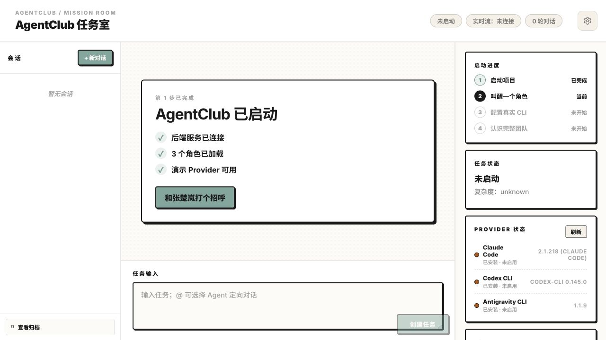
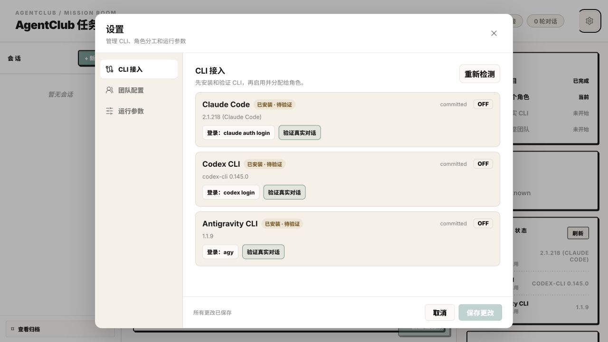
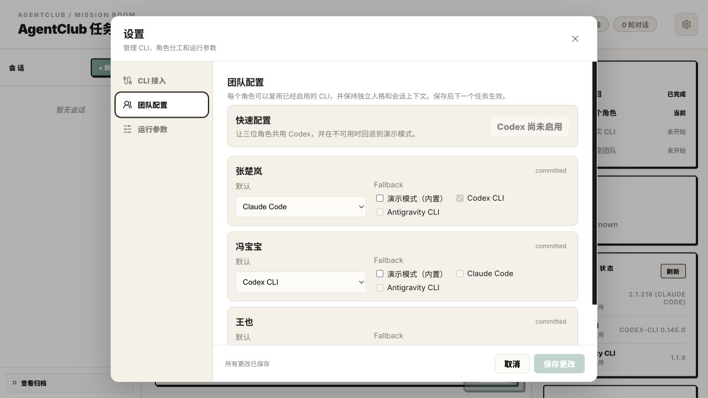

<p align="center"></p>

# Unity

> Turn Codex CLI, Claude Code, and Antigravity CLI into a configurable, collaborative, and observable local Agent team.

[](LICENSE)
[](CHANGELOG.md)

[简体中文](README.md) | **English**

## What is Unity?

Once users have more than one AI CLI, calling a model is no longer the hardest part. The real challenge is deciding who should do the work, preserving context across turns, recovering from provider failures, and understanding what each Agent actually produced.

Unity is a local Agent team workspace built on top of existing AI CLIs. It turns a user goal into an observable collaboration process: three distinct personalities exchange views, respond to each other, and advance the work requested by the user. A Provider Router then selects the appropriate CLI for each turn.

```text
User goal
   ↓
Agent teamwork: distinct personalities / shared abilities / continuous dialogue
   ↓
Provider Router: primary provider + fallbacks
   ↓
Codex CLI / Claude Code / Antigravity CLI
```

Roles, workflows, and conversation context remain stable while models are treated as configurable execution providers. Users can change the underlying CLI without rebuilding the way their Agent team works.

## What can Unity do?

### Get users to a first successful conversation

On first run Unity detects the installed CLIs and lets the user pick one. Zhang Chulan replies through it, which also verifies the connection, and then the whole team switches to it. When no CLI is installed, onboarding shows install and login steps.

### Turn one goal into multi-Agent teamwork

Unity schedules roles according to task complexity and also supports directing a task to a specific role. Zhang Chulan is socially perceptive and pragmatic; Feng Baobao is candid, curious, and attentive to concrete facts; Wang Ye is relaxed, independent, and mindful of long-term choices. All three can propose, analyze, execute, and summarize. Their views can change with evidence. Without mentions, turns follow configuration order rather than job keywords; multiple mentions retain the selected order.

### Manage multiple AI CLIs in one place

The Settings page detects installed CLIs, guides authentication, verifies a real MCP conversation, and assigns a primary provider and fallbacks to each role. Unity currently supports Codex CLI, Claude Code and Antigravity CLI.

### Make Agent execution observable

The mission room shows task status, Agent turns, the provider actually used, fallback attempts, MCP tool calls, Agent-to-Agent routing, artifact ownership, and blocking diagnostics. Users can inspect both the result and the process that produced it.

### Preserve local context and artifacts

Users can continue work in the same conversation, archive and restore previous conversations, and keep generated artifacts isolated by mission. Conversation state, settings, and artifacts remain local by default.

## Why Unity?

### 1. Roles and providers are decoupled

This is the central product principle behind Unity. A role defines **who is working**. A provider defines **which model executes the work**. Routing determines **which provider to try first and what to use when it fails**.

| Layer | Responsibility | Example |
| --- | --- | --- |
| Role | Personality, perspective, communication habits, conversation identity | Perceptive Chulan, candid Baobao, independent Wang Ye |
| Provider | Model capability, CLI command, authentication, runtime behavior | Codex CLI, Claude Code, Antigravity CLI |
| Routing | Primary provider, fallbacks, and failure recovery | Claude → Codex |

This separation creates four practical benefits:

- One verified Codex connection can power the complete Agent team.
- Different providers can be assigned to roles according to the task.
- A failed or unavailable CLI can fall back without stopping the entire mission.
- Changing the model does not change role identity, team workflow, or conversation context.

### 2. Value comes before configuration

Unity separates product activation from real-model setup. Onboarding first detects the installed CLIs and verifies one of them with a real first conversation; when none is installed it shows install and login guidance. Other CLIs can be added later. A failed verification does not overwrite the current team configuration or make the room unusable.

### 3. MCP provides an auditable Agent communication path

For MCP-enabled providers, only `publish_message` creates a visible Agent message; CLI stdout remains diagnostic output. Agents can also read context, write artifacts, update status, and invoke another Agent through MCP. Messages, tools, handoffs, and artifacts therefore belong to the same traceable mission record.

### 4. Local-first without becoming a black box

Conversation data, settings, and artifacts are stored locally, while SSE updates, turn tracking, tool events, blocking diagnostics, and archive recovery keep the runtime observable and debuggable.

### 5. From a single answer to a team workflow

Unity is designed around a process—plan, execute, review, and close—not just a generated response. Distinct personalities, continuous conversations, Agent handoffs, and artifact attribution provide a foundation for reusable team templates, task workflows, and provider-routing strategies.

### 6. Evaluable: measure when multi-agent actually helps

Multi-agent collaboration should not be justified by vibes alone. The repository ships an A/B/C/D evaluation harness that runs Single Agent, Self Reflection, a fixed multi-agent workflow, and dynamic A2A on the same tasks, lead agent, and rubric. B and C share the same 4-turn checking skeleton, and personas are neutral by default; the report covers quality, cost, latency, redundancy, and regressions.

```bash
# Harness validation, no model calls
.venv/bin/python scripts/run_eval.py --mode fixture

# Real comparison: pin one provider, 12 tasks, 3 repeats
.venv/bin/python scripts/run_eval.py --mode real --provider codex --repeats 3
```

The report flags category/task-level quality regressions and cases that spend 2×+ tokens without a quality gain. See [the evaluation guide](docs/EVALUATION.md) for task design, metric definitions, validity boundaries, and how to extend the suite.

## Product Demo

These screenshots were captured before the rename and show the former AgentClub branding.

### First-run onboarding



### CLI access and verification



### Team routing configuration



## Quick Start

### macOS app

1. Download the latest `Unity-<version>-arm64.dmg` from [Releases](https://github.com/Buaixihongshi/Unity/releases). Only Apple silicon builds are available for now; macOS 12 or later is required.
2. Open the dmg and drag Unity into Applications.
3. Preview builds are not notarized by Apple yet. Before the first launch, run once in Terminal:

   ```bash
   xattr -dr com.apple.quarantine /Applications/Unity.app
   ```

4. Open Unity from Applications or Launchpad, then follow the first-run onboarding to connect a CLI.

The app bundles its own runtime, so Python and Node are not needed. It reads `PATH` from your login shell, so CLIs installed through nvm, Homebrew and similar tools are found.

- Data lives in `~/Library/Application Support/Unity/`; the partners' working directory is `workspace/` inside it. Logs go to `~/Library/Logs/Unity/backend.log`. The Unity menu opens both locations.
- Before using Workflow (autonomous development), choose a Git repository from **Unity › Choose Project Repository…** (选择项目仓库…). Each task gets its own `codex/task-…` branch in that repository, with its worktree under `task-worktrees/` in the data directory. Without a repository, chats and discussions still work and Workflow tasks ask you to choose one.
- If work is still running when you quit, Unity asks for confirmation first.
- To uninstall, delete `/Applications/Unity.app`, and the data directory above if you no longer need it.
- To build the app yourself, see [packaging/macos/README.md](packaging/macos/README.md).

### Run from source

#### Requirements

- macOS or a Linux shell environment
- Python 3.11+
- Node.js `20.19+` or `22.12+`
- npm

The first run asks you to install and sign in to one supported CLI (Codex CLI, Claude Code or Antigravity CLI).

#### Start Unity

```bash
git clone https://github.com/Buaixihongshi/Unity.git Unity
cd Unity
./scripts/start.sh
```

The script installs missing local dependencies, starts FastAPI and Vite, waits for the health check, and opens `http://127.0.0.1:5173/`. Press `Ctrl-C` to stop both services.

Useful options:

```bash
./scripts/start.sh --no-open
./scripts/start.sh --no-install
./scripts/start.sh --reset-onboarding
```

Use different ports when the defaults are occupied:

```bash
PORT=8001 FRONTEND_PORT=5174 ./scripts/start.sh --no-open
```

## Recommended First-Run Path

1. Install and sign in to one supported CLI (Codex CLI is recommended).
2. Let Zhang Chulan greet you through it; this verifies one real MCP conversation.
3. Let all three roles reuse the verified connection.
4. Add Claude Code or Antigravity CLI when a task benefits from them.
5. Configure the primary provider and fallbacks for each role in Team Settings.

Real CLI verification sends one model request through the corresponding account and may consume plan quota or incur charges. Installation, login detection and version detection do not call a real model.

### Supported providers

| Provider | Command | Purpose | Default repository state |
| --- | --- | --- | --- |
| Demo Mode | Built in | Offline tests and explicit `--demo` environments | Enabled |
| Codex CLI | `codex` | Recommended first real provider; can power the full team | Disabled until verified |
| Claude Code | `claude` | Optional role provider | Disabled until verified |
| Antigravity CLI | `agy` | Optional role provider | Disabled until verified |

Unity never enables a real provider merely because the application started. Installation and login guidance is available in onboarding and Settings. A failed verification keeps the previously saved routing unchanged.

## How It Works

```text
React / Vite UI
       │ REST + SSE
       ▼
FastAPI ── MissionRunner ── Provider Router ── Local AI CLIs
   │              │                              │
   │              └──────── MCP tools ──────────┘
   ▼
SQLite event and conversation state + artifacts/<mission_id>/
```

- FastAPI creates a mission and runs role turns in a background workflow.
- The Provider Router selects a real CLI and tries configured fallbacks; explicit `--demo` and test environments use an offline adapter instead.
- MCP carries Agent messages, context reads, artifacts, status updates, and Agent-to-Agent calls.
- The frontend consumes SSE snapshots and renders turns, progress, and diagnostics.

## Local Data and Privacy

Unity is local-first and does not provide a hosted account or remote data service. Runtime data is stored under:

| Path | Contents |
| --- | --- |
| `data/` | SQLite conversations, missions, and local settings |
| `artifacts/` | Agent-generated mission artifacts |
| `.yiren/` | Local startup logs and dependency stamps |

These directories are excluded from the public repository. Codex and Claude MCP settings use temporary isolated directories rather than permanently modifying global MCP configuration. Antigravity uses a guarded lifecycle with locking, restoration, and crash recovery.

Run the release privacy check before publishing a repository or attaching local files to an issue:

```bash
python3 scripts/privacy-check.py
```

## Development and Verification

Run the deterministic offline release gate:

```bash
./scripts/release-check.sh
```

It runs the backend and frontend test suites, creates a production build, and exercises onboarding, conversation continuity, and multi-Agent mission smoke flows without calling a paid model.

Real CLI verification is explicit because it requires authenticated CLIs and may consume model quota:

```bash
./scripts/release-check.sh --real-cli
```

## Current Scope

- Unity is currently a local, single-user MVP without hosted deployment, remote sync, or multi-user permissions.
- User interruptions are consumed between turns and do not forcibly terminate a CLI process that has already started.
- Real-provider availability depends on the installed CLI version, authentication state, and account quota.
- Agent artifacts should be written under `artifacts/<mission_id>/`; avoid using sensitive workspaces for real-model verification.

## Contributing

Issues, reproducible bug reports, and focused improvements are welcome. Before submitting a code change, run:

```bash
./scripts/release-check.sh
python3 scripts/privacy-check.py
```

See [CHANGELOG.md](CHANGELOG.md) for release notes and [docs/ACCEPTANCE.md](docs/ACCEPTANCE.md) for the current acceptance status.

## License

Unity is released under the [MIT License](LICENSE).
