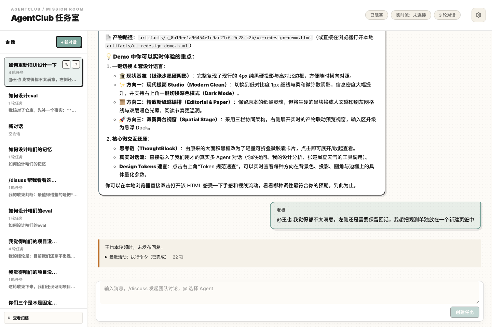
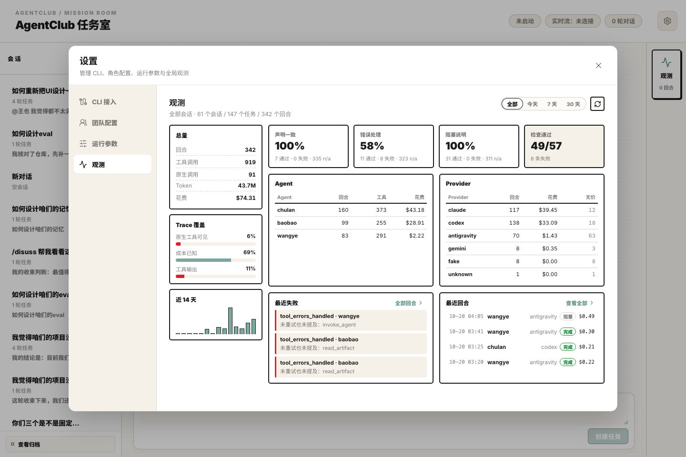
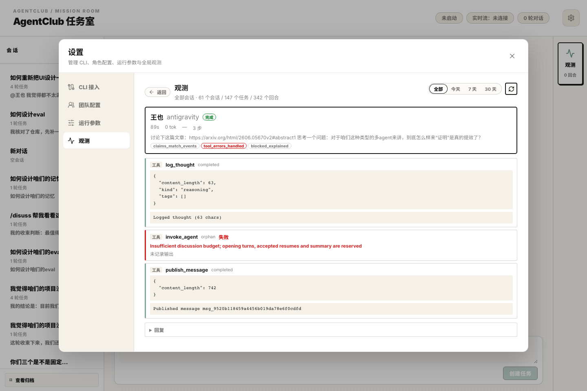

# 回合观测（Observability）

> 观测入口：**设置 → 观测**。它读的是**回合**，不是 swimlane 图形；数据跨全部会话。
> 实现：`frontend/src/components/ObservabilityOverview.tsx`；
> 接口：`GET /api/observability/overview`、`GET /api/observability/turns/{turn_id}`、`GET /api/observability`。

## 它回答什么

| 问题 | 字段 |
|---|---|
| 这一轮做了什么？ | `turns[].steps[]`（工具 / 原生调用 / 协作 / 产物） |
| 做得对不对？ | `turns[].checks[]`（读时计算，1 / 0 / n/a） |
| 花了多少钱？ | `turns[].cost_usd` + `summary.spend`（provider 报价优先，估算次之） |
| 这份 trace 可信吗？ | `summary.coverage`（原生工具可见率、成本已知率、工具输出率） |

## 为什么是"回合"

任务（mission）是产品单位，回合（turn）才是可判定的单位：一次发言、一次工具调用、一次委派都发生在回合里。事件表本来就带 `turn_id`，这个模块只是把散在 `events` + `messages` 里的东西按回合折起来。

## 三个设计规则

1. **读时计算，不落库。** 检查是纯函数，页面每次读都重算。改一条检查，历史所有回合立刻重新评分；不需要迁移，也不会留下"旧分数"。
2. **`n/a` 是一等公民。** 判断不了就说判断不了。`claims_match_events` 只在**回复与事件矛盾**时 fail（例如"已委派"但本回合只有 `a2a.skipped`），没有证据时为 n/a。
3. **覆盖率与检查并列展示。** 一个页面只报失败、不报"我能看到多少"，会教人忽略它。原生工具可见率、成本已知率、工具输出率就是为了说明 n/a 的来源。

## 数据从哪来

### 1. 回合与步骤

`backend/app/observability/turns.py`：

- `tool.call` / `tool.result` / `tool.error` → `kind: "tool"`，按"同回合、同工具、先到先配"配对；
- `provider.activity` → `kind: "native"`（CLI 自带的文件/命令工具）；
- `a2a.invoke` / `skipped` / `reply` → `kind: "a2a"`；
- `artifact` → `kind: "artifact"`；
- `turn.usage` → tokens 与成本；
- `messages` 里该回合最后一条 agent 消息 → `reply`。

没有 `turn.completed` 的回合是 `running`，不是 `failed`。

### 2. 检查

`backend/app/observability/checks.py`：

| 检查 | 通过 | 失败 | n/a |
|---|---|---|---|
| `claims_match_events` | 回复里的行动声明与本回合事件一致 | 声明与事件矛盾（已委派但 `a2a.skipped`、称已完成但回合 blocked、称写入但 `write_artifact` 报错） | 没有声明，或声明无事件可判 |
| `tool_errors_handled` | 每个失败调用都被重试，或回复里点名说明 | 有失败调用，既没重试也没提 | 本回合没有失败调用 |
| `blocked_explained` | 失败/阻塞的回合记录了原因或回复里说明 | 失败且没有任何说明 | 回合正常结束 |

检查自己抛异常时记为 n/a + `"check error"`，不会让页面空掉。

### 3. 成本

`backend/app/observability/pricing.py`：provider 报了 `total_cost_usd` 就用它；否则按 provider 的粗估费率算，并在 UI 上标 `≈`。没有费率的 provider 返回 `None`（显示 `—`），**不是 $0**——零会静默低估花费。

### 4. 步骤里到底显示什么

一次调用只显示"发生过"没有意义，所以每一步都尽量带上内容：

| 来源 | 显示 |
|---|---|
| MCP `log_thought` / `publish_message` | 思考正文 / 消息正文（脱敏后截 2000 字符） |
| MCP `read_context`（v2 冻结上下文） | `phase · round · results · issues · materials · history` + 任务原文 + 其他 Agent 的观点摘要 + 材料路径 |
| MCP `write_artifact` | `路径 · 字数 · sha256`；`read_artifact` 显示正文；`read_discussion_result` 显示冻结页面 |
| codex `shell` | 命令 + 退出码 + 输出字节数（如 `git status → exit 0 · 5892 chars`） |
| codex `web_search` | 查询/URL + 结果条数 + 首条标题 |
| codex `mcp_tool_call` | 不显示：它是 MCP 工具的另一份记录，已由 `tool.call` 覆盖（按 `mcp:` 前缀过滤） |
| claude `Read` / `Bash` / `Grep` … | `工具 · 关键参数`（`Read · /tmp/a.py`、`Bash · pytest -q`），参数从 `input_json_delta` 累积解析 |
| antigravity | 沿用其自带的 `读取文件 · xxx` 摘要 |

### 5. 采集补强（同批完成）

- `stream_parsers/codex.py`、`claude.py` 现在给 `TOOL_ATTEMPT` 带上 `activity_id`、`tool_phase` 和一句 `tool_summary`。此前只有 antigravity 带，落库条件 `if ev.activity_id` 把 codex/claude 的原生工具全部丢掉了。
- `record_tool_result` 新增可选 `output`：`read_artifact` 保存正文，`write_artifact` 保存 `路径 · 字数 · sha256`，`read_discussion_result` 保存页面文本。写入前统一脱敏 + 截断到 2000 字符（`sanitize_tool_output`），`summary` 保持原样。
- `provider.activity` 跳过 `mcp__*` 工具：它们已经有自己的 `tool.call`，不需要两份。

## 布局

右侧栏的观测入口已删除，会话主区域不再预留侧栏宽度：



## 设置页签（全局观测）

观测不再只属于某个会话：设置 → **观测** 汇总**全部会话**的数据，按时间窗口（全部 / 今天 / 7 天 / 30 天）统计。



- 默认页（v2）：左侧总量 / Trace 覆盖率 / 近 14 天趋势；右侧三个检查项 + 检查通过率、Agent 与 Provider 两张表、最近失败。
- 下钻（v3）：点「全部回合」进入检查项表 + 最近回合表（Agent、Provider/模型、状态、耗时、Tokens、花费、检查标签）。
- 回合细节：点最近失败、最近回合或表格行，打开该回合的步骤（工具 / 原生 / 协作 / 产物）、参数、输出、错误、检查项与回复；「返回」回到进入前的视图。



数据来自 `GET /api/observability/overview?window=all|today|7d|30d&limit=12`，单回合细节来自
`GET /api/observability/turns/{turn_id}`（按 `events.payload.turn_id` 反查 mission，再复用同一套 build_turns）。实现在
`backend/app/observability/overview.py`：逐任务读取事件、按窗口过滤回合、复用同一套
`build_turns` + `run_checks`，所以设置页与会话内观测看到的是同一份事实。

窗口按**本机时区**切分（应用跑在用户电脑上），不是 UTC。

## 事件字段约定（CLI ↔ MCP）

三个 CLI 的流协议不同，但它们都归一成同一组事件字段。2026-10-20 补齐了缺的那部分，并落进 `events` 表：

| 事件 | 字段 |
|---|---|
| `provider.session` | `turn_id` `agent_id` `provider_id` `session_id` `model` |
| `provider.activity` | `activity_id` `tool_name` `phase`（started / completed / failed / result）`summary` `args` `output` `ok` `error` `duration_ms` |
| `tool.call` | `tool_name` `tool_input` `call_id` |
| `tool.result` | `call_id` `ok` `duration_ms` `summary` `output` |
| `tool.error` | `call_id` `ok: false` `duration_ms` `error` |
| `turn.usage` | `usage`（tokens / cost）`model` `stop_reason` `duration_ms` |

三个 CLI 各自能填什么：

| 字段 | claude | codex | antigravity |
|---|---|---|---|
| model | `modelUsage` → `provider.session` | 不提供（null） | init 里不提供（null） |
| 工具参数 `args` | `tool_use` 的 input | `arguments` / `command` | `tool_info.parameters` |
| 工具输出 `output` | `tool_result` 块（新增解析） | `aggregated_output` / `result` | `tool_info.output`（新增，之前丢弃） |
| 成功/失败 `ok` | `is_error` | `status` / `exit_code` | step state |
| 耗时 `duration_ms` | started→completed 的流时间差 | 同左 | 同左 |

写入前统一过 `sanitize_tool_args` / `sanitize_tool_output`：键名像密钥的置 `***`，值里 `token=`、`Bearer …`、`sk-…` 这类形状打码，`output` 截断 2000 字符。`phase` 为 started/completed/result 的同一 `activity_id` 在读取侧合并成一步，不会在面板里出现三行。

## API

```http
GET /api/observability?mission_id=<id>&limit=50&mission_limit=20
```

- `mission_id` 省略时，扫描最近 `mission_limit` 个任务；
- `limit` 控制返回的回合数（最新在前），但 `summary` 始终覆盖范围内的**全部**回合，截断不会抬高通过率。

响应结构见 `frontend/src/types.ts` 的 `ObservabilityPayload`。

## 前端

- 入口只有 **设置 → 观测**（`ObservabilityOverview.tsx`），右侧栏按钮与弹窗已删除；
- 三级视图：总览 → 回合明细 → 单回合细节；窗口切换与刷新走同一份接口数据；
- 单回合细节显示步骤、参数、输出、错误、检查项与回复。

## 测试

```bash
.venv/bin/python -m pytest backend/tests/test_observability.py -q
cd frontend && npx vitest run src/tests/ObservabilityOverview.test.tsx
```

**验收必须跑真实 CLI。** fake 适配器只能验证链路（它不产生原生工具调用，也不走 v2 隔离），内容回显的验收标准是：一个真实 codex / claude 任务跑完后，`tool.result` 与 `provider.activity` 都带非空 `output` / `summary`，面板里每一步都能读到正文。

```bash
# 隔离实例（端口 8206），真实 CLI，不碰日常数据库
mkdir -p .yiren/realcheck/data .yiren/realcheck/artifacts
cp data/hub_settings.json .yiren/realcheck/data/
PYTHONPATH=. YIREN_DATABASE_PATH=.yiren/realcheck/data/app.sqlite3 \
  YIREN_ARTIFACT_ROOT=.yiren/realcheck/artifacts YIREN_USE_FAKE_CLI=false \
  .venv/bin/python -m uvicorn backend.app.main:app --port 8206
```

v2 讨论需要 macOS `sandbox-exec`；在受限沙箱里启动的进程无法再嵌套调用它，必须用有权限的终端启动。

## 已知边界

- `claims_match_events` 是启发式抽取（重视精确率），只抓"委派 / 产物 / 执行 / 核对 / 完成"五类；
- 工具输出只保留前 2000 字符，足够核对措辞，不够做全文比对；
- `provider.activity` 目前只有 antigravity 会同时报 started/completed；codex/claude 补上 id 后还需要真实跑一轮确认两条相位都落库；
- v2 讨论走独立隔离进程，CLI 的原生工具调用不进 `provider.activity`，所以 v2 回合的"原生工具可见"是 0%，这不是 bug，是当前边界；
- 讨论型（roundtable）回合的"声明"多是观点，检查命中率天然低，这是 n/a 而不是失败。
