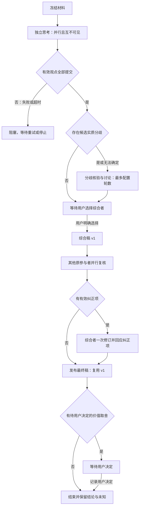

# 圆桌讨论 V2 SPEC：独立思考、分歧核验与可追溯综合

日期：2026-10-19；更新：2026-10-20。状态：本地 V2 闭环已实现；离线协议、受限进程、浏览器演示与三种真实 Provider 的六阶段连通性已验证，真实项目议题的讨论质量尚未验收。

适用范围：Agenthub 的 `room_mode=roundtable`。依据：用户提供的六阶段讨论流程，以及圆桌代码和真实讨论记录。协议名为 `deliberation_v2`；实现入口见第 14 节。公共提示词规则只是其中一层，不能替代隔离、阶段屏障和人工节点。

## 1. 问题与目标

当前圆桌按参与者顺序发言，每次读取最新聊天历史。后发言者从第一轮就能看到前面的回答，发言目的又要求“回应前面具体观点”，容易出现首位定框架、后两位沿用框架并互相认可的情况。固定轮转直到预算耗尽，也会增加重复认可和重复总结。

本次目标是让参与者先提交相互隔离的初始判断，只围绕影响决定的分歧交流，由用户选择一名原参与者综合，再由其他原参与者检查遗漏和误读。最终结果允许保留分歧和未知。

本协议不追求更多反对词，也不保证多 Agent 天然比单 Agent 正确。共同错误依然可能发生；结论可靠性由证据和适用的验证决定，不能用赞同人数代替。

### 1.1 必须保持的约束

1. 第一阶段的独立性由宿主上下文、工具和运行环境保证，不能只靠“不要偷看”的提示词。
2. 同一阶段的并行任务使用相同的材料快照。后完成者不能获得先完成者的新输出。
3. 综合者是用户指定的临时职责，不绑定张楚岚、冯宝宝、王也或某个 Provider。
4. 事实一致、方案一致、偏好一致分别记录；任何一种一致都不自动等于已验证。
5. 无实质分歧则跳过辩论；没有新增信息则提前结束，不能为了凑轮次要求发言。
6. 原始判断不可覆盖，改变判断必须保留新增依据和版本关系。
7. 技术建议只能在已给定目标、约束和授权内收束；目标、风险偏好等价值取舍交给用户。
8. 讨论、综合和知识候选都不自动授权修改代码、发布或写入长期记忆。

### 1.2 首版范围

- 支持 2～3 位参与者，沿用当前 Agent 配置与 Provider 路由。
- 六阶段闭环、结构化观点与分歧、人工选择综合者、原参与者复核。
- 分阶段只读材料、隔离输出、阶段屏障、并发回合租约、幂等操作与恢复。
- 讨论默认最多 2 轮，允许配置 2～3 轮；实际执行可为 0 轮（跳过或核验后无分歧）。
- 保留现有任务模式和旧圆桌记录，不自动迁移正在执行的旧协议。

不在首版范围：第四位常驻裁判、自动多数投票、无限辩论、任意 A2A 插队、自动代码执行、跨会话长期记忆自动沉淀。

## 2. 六阶段流程

| 阶段 | 执行者与输入 | 交付与转移条件 |
| --- | --- | --- |
| 1. 独立思考 `independent` | 所有参与者并行；共享冻结材料，各自隔离会话 | 每人提交一份有效观点；全部成功后统一解封 |
| 2. 分歧讨论 `exchange` | 相关参与者；初始观点及上一完整轮的快照 | 无实质分歧则跳过；有分歧最多讨论 2～3 轮，未解问题原样保留 |
| 3. 选择综合者 `awaiting_synthesizer` | 用户查看观点、分歧及参与者 | 用户显式选择原参与者之一；不超时默认选择 |
| 4. 扇入综合 `synthesis` | 被选综合者；所有有效观点、分歧及证据索引 | 生成带来源的综合稿 v1，不能覆盖原观点 |
| 5. 原参与者复核 `review` | 除综合者外的原参与者并行；同一综合稿快照 | 各自提交遗漏、误读或证据问题；有问题进入一次有界修订 |
| 6. 最终收束 `finalizing` | 综合者；综合稿和全部复核结果 | 发布最终结果及修订记录；必要时等待用户价值选择 |

Phase 2 的“跳过”指不进入辩论，不代表可以免费、可靠地推断任意自然语言答案是否一致。宿主只比较结构化决策信号：同一 `decision_key` 的建议和适用条件一致、至少两位明确给出的关键假设和建议行动不冲突，且至少有一个共同决策项时，才记录 `exchange_skipped`。陈述措辞、来源顺序、证据状态和未知列表不单独构成冲突。无法确定时，只邀请与冲突决策项相关的 claim 作者参加第一轮核验，不再让无关参与者陪跑。

### 2.1 状态转移



`phase` 表示六阶段业务位置；失败、用户等待等由 `Mission.status` 和 `awaiting_reason` 表达。停止可发生于任意未终结阶段，停止后不生成额外总结。

## 3. Phase 1：独立思考

### 3.1 冻结输入

开始时生成 `context_snapshot_id` 和单调递增的 `context_revision`，冻结：

- 用户当前议题、已明确的目标、约束和验收条件。
- 截至指定消息/事件边界的历史对话与用户提供的材料。
- 已选参与者及各自角色设定、公共讨论规则版本。
- 代码或文件材料的固定版本与可读取范围；需要引用时保留路径、版本和内容哈希。

角色设定允许不同，基础任务材料必须相同。记录共享材料哈希与每个 Agent 的完整输入哈希，不能因为完整提示词不同而误判基础材料不一致。

已有历史中可能包含前一场的共同框架。界面应说明本协议保证的是“本场首轮输出互不可见”，不宣称抹除了历史影响。用户可选择新议题只使用明确材料，或者使用带来源的历史快照。

### 3.2 可见性与工具隔离

| 通道 | 独立思考阶段的规则 |
| --- | --- |
| Prompt | 只包含冻结输入，不拼入本场已经完成的其他 Agent 输出 |
| `read_context` | 返回同一个冻结投影，不读取正在增长的 conversation 历史 |
| `read_artifact` / 材料读取 | 只读冻结的授权材料；禁止读取本场其他 Agent 的草稿、日志及新产物 |
| `publish_message` | 本阶段替换为结构化提交能力；结果封存，不能提前进入其他 Agent 可读历史 |
| `invoke_agent` | 禁用并由服务端拒绝，不能绕过独立阶段向他人求答 |
| CLI 会话 | 每位参与者使用独立会话/工作目录，不复用其他参与者的会话状态 |
| 原生文件与终端工具 | 只允许阶段授权的材料访问；不能读宿主数据库、运行日志、共享输出目录或其他 Agent 工作目录 |
| stdout / partial / thought | 作为诊断或私有进度；不能充当他人已正式提交的观点 |

以上校验须覆盖 in-process 与 stdio MCP。`mission_id`、`turn_id`、`attempt` 和阶段权限由宿主绑定，不能信任 Agent 自报身份。

单独改变工作目录并不能限制绝对路径读取。支持 V2 的适配器必须有可验证的工具限制或执行隔离；无法阻止旁路读取的 Provider 不得显示为“已隔离”，应在启动前返回 `isolation_not_supported`。不能沿用无约束原生工具后声称实现了禁止互看。具体 Provider 的限制机制在接入 PR 中验证，不在本 SPEC 中假定某个 CLI 参数一定有效。

### 3.3 并行与提交屏障

- 宿主先在短事务中为所有参与者预留阶段租约，再分别启动运行；网络/模型调用不得占用 SQLite 写事务。
- 首版每个阶段并发上限为 3。共享 Provider 账号、全局配置锁或并发限制导致排队时，界面显示真实的排队状态。
- 即使某个 Provider 必须串行执行，其结果仍按同一快照隔离。不能把资源排队伪装为已经并行调用，也不能因此提前解封。
- 一名参与者提前提交，其输出仍为 `sealed`。所有必需提交有效后，宿主在一个事务中解封全部观点并推进阶段。
- 失败、格式无效或超时不能等同于“暂无补充”。首版不自动移除参与者；重试沿用同一快照，或者由用户停止后重开。
- 重复提交幂等；租约失效、阶段版本过期或失败 attempt 的迟到输出不能成为有效观点。

UI 可展示每人的运行进度，但在屏障完成前不展示正文，避免人类根据先完成者的观点中途引导剩余参与者。

## 4. Phase 2：只讨论实质分歧

### 4.1 分歧的定义

实质分歧：在同一目标和约束下，观点在事实判断、方案选择、关键假设、必要行动或风险接受条件上不兼容，且差异可能影响最终决定。

以下不能直接算分歧：措辞不同、先后顺序不同、同一方案的互补细节、没有依据的反对、单纯“我也认同”。信息不足单独标记为 `needs_information`；价值偏好冲突标记为 `needs_human`，不要求 Agent 争论出统一答案。

### 4.2 建立议题账本

1. 解封后，宿主按明确的 `decision_key` 和引用关系合并可确定匹配的决策项。
2. 宿主对每条 `decision_key` 归一化比较建议与适用条件，并比较至少两位明确给出的关键假设和建议行动；均不冲突且至少有一个共同决策项时，记录 `exchange_skipped`，不启动 Phase 2 模型调用。
3. 不同自然语言表达无法可靠归并时，不用陈述措辞、字符串差异、反对词或赞同人数判定。只把与冲突决策项相关的 claim 作者作为相关参与者，交给第一轮交叉核验。
4. 核验者必须引用具体 `claim_id`，说明“不兼容在哪里、影响什么决定、需要什么证据”。不能只写“我不同意”。
5. 候选确认后保留为稳定 `issue_id`；后续轮次只邀请仍有开放 issue 的 claim 作者。纯互补项归为补充信息，不继续辩论。

首版不增加第四位模型裁判。第一轮交叉核验由原参与者完成；该轮如果只确认了互补关系或无实质问题，立即进入选择综合者。

### 4.3 轮次与增量

一个讨论轮次是相关参与者各最多一次提交，不是一条消息，也不是每人接着上一位实时回应。每轮以固定 `exchange_snapshot_id` 为输入，轮内提交并行且暂不互看，轮末统一解封；下一轮才能使用本轮新增信息。

每个提交须关联 `issue_id` 或待归并的 claim 引用，给出新增证据、反例、约束、建议修订或待验证办法；允许提交结构化 `no_addition`。第一轮核验时可申报新的候选议题。

分歧状态只能是：`open`、`resolved`、`unresolved`、`needs_information`、`needs_human`。`resolved` 必须记录依据、相关提交及各原有立场如何被处理；一方声称“已经解决”或多数票不足以改变状态。仍存在不兼容的有效立场时保留 `unresolved`。

### 4.4 退出条件

- 没有实质分歧：记录 `exchange_skipped`，进入 Phase 3。
- 本轮已没有需要继续核验的开放问题：提前退出。
- 仍有分歧，但所有相关参与者返回 `no_addition`，且没有待执行的本阶段核验：标记 `no_new_information`，保留未解问题后退出。
- 达到 `max_exchange_rounds`：标记 `exchange_budget_exhausted`，保留分歧，不继续加轮。
- 缺少外部信息或价值选择：列为待决事项；不能通过重复讨论猜出用户偏好。

宿主验证结构与引用，记录模型申报的增量；不能声称仅凭字段就自动证明信息在语义上全新。公共规则继续约束无依据的认可和伪造异议。

## 5. Phase 3：用户选择综合者

进入 `phase=awaiting_synthesizer`、`status=awaiting_input`、`awaiting_reason=select_synthesizer` 后，停止启动模型任务并释放工作线程。会话仍占有活动任务锁，刷新、离线或服务重启不能丢失等待状态。

界面展示原始观点、分歧账本、讨论结束原因和可选参与者。用户必须明确点击某位原参与者并确认“由其综合”；不自动选择首位、最后一位、首席架构师或发言最多者，不设超时默认人选。

选择与入队在同一事务中持久化。并发选择只有一项成功，旧页面或不同人选的冲突返回 409；同一个 `request_id` 的网络重试返回原结果，不能重复生成综合稿。

首版选择生效后不在原任务中更换综合者。若其全部 Provider 都失败，可对同一逻辑回合重试；需要换人时停止本次任务并新建续议任务，明确引用当前快照，避免出现双综合者。

## 6. Phase 4：扇入综合

综合者读取完整的有效观点与分歧快照，必要时按 ID 分页读取原文。不能只读取最近 8 条对话，或用已经截断的聊天上下文替代全部输入。材料超出上下文预算时采用显式索引和按需读取，保留未读标记，不能静默丢弃少数意见。

综合稿必须包含：

| 部分 | 内容要求 |
| --- | --- |
| 建议结论 | 针对原问题的建议、适用范围和置信依据，不把建议写成既定事实 |
| 共识 | 谁在什么条件下认可；分别标记仅意见一致和已有证据验证 |
| 分歧 | 各方案、支持依据、反对依据和未解原因；保留来源 ID |
| 待决事项 | 缺失信息、尚未验证的关键假设、需用户选择的价值取舍 |
| 行动项 | 建议动作、建议负责人、前置条件与验证方式；不能视为执行授权 |
| 来源索引 | 关键结论对应的观点、证据和 issue 引用 |

输出为版本化 `SynthesisDraft`，默认 v1。普通聊天可展示其可读投影，结构化数据是状态机与复核的依据；UI 不直接展示 JSON。

## 7. Phase 5：原参与者复核

- 复核者为除综合者外的所有原参与者；三人场景为两位，两人场景为一位。
- 复核者基于同一份综合稿版本并行提交，不能看到对方本轮复核结果。
- 每人能读取全部已解封讨论及自己的原始观点，检查自己的观点是否被准确表达，同时检查事实、遗漏和来源关系。
- 复核关注 `misrepresentation`（误读）、`omission`（遗漏）、`unsupported_claim`（无依据结论）、`constraint_violation`（违反约束）及 `source_error`（来源错误）。本阶段不重开无限方案争论。
- 每条纠正项引用 `draft_section_id` 和原始观点/材料，说明影响、期望修正以及是否阻断使用。单纯偏好不同归入分歧，不自动阻断。
- 没有发现问题时提交 `no_findings`，无需再写一段认可综合者的话。`no_findings` 只是本次复核未发现问题，不代表客观正确。
- 缺少任意必需复核结果时不能宣称已复核通过。失败进入 `blocked`，保留草稿，允许有界重试。

## 8. Phase 6：有界修订与最终收束

### 8.1 修订规则

所有复核均为 `no_findings` 时，宿主直接把 v1 标为最终稿，无需再调用模型写一遍。

存在有效纠正项时，综合者最多获得一次修订回合。修订须逐条返回 `accepted`、`partially_accepted` 或 `not_accepted` 及依据，不能静默删除纠正项。无法核验的事实明确降为待验证，不能仅靠综合者否认就标记解决。

首版避免增加第二轮全文复核：修订只允许处理已有纠正项，不增加新的建议或扩大方案范围。未涉及纠正的结构化 section ID、内容及来源必须保持；宿主做差异校验。违反修订范围则该次提交无效，不把重写稿冒充已复核结果。

最终记录同时显示“v1 已由谁复核”“修订由谁完成”“修订未再次独立复核”。有效阻断项未解决时，结果标记为有保留，不能声称验收通过；后续需要新一场定向核验。

### 8.2 技术判断与价值取舍

- 目标和验收条件明确、验证证据充分的技术问题：可形成带适用条件的技术结论。
- 综合稿必须对每个非 `needs_human` 的 issue 在 `issue_decisions` 中给出 `resolved`、`unresolved` 或 `deferred` 及技术决定；有未解技术问题时保留并触发有保留结束，不能静默省略。
- 预算优先级、产品方向、风险接受程度等价值取舍：展示选项、依据、代价和推荐理由，交由用户决定。`needs_human` issue 只能进入 `decisions`，不得由综合者在 `issue_decisions` 中代替用户决定。
- 技术与价值混合的问题拆开记录；无法确定属于哪类时按需人工决定处理。
- 有必需的价值选择时，最终稿发布后进入 `awaiting_input`，原因 `resolve_value_choice`。不默认接受推荐，不将用户沉默当作同意。
- 用户可在已有备选项中决定，或明确保留/延后该事项；记录后任务结束。新约束或需要继续推理的自由文本转为新任务，不能悄悄追加无预算模型回合。
- 知识沉淀默认关闭。用户显式选择后才保存带来源、适用范围、日期及未决风险的知识候选；未经授权不写入长期记忆，不把未验证共识升级成知识。

## 9. 数据与协议契约

以下为新协议的建议类型；实施时以 Pydantic schema 为唯一校验来源。

### 9.1 创建配置

```json
{
  "goal": "讨论该项目下一阶段应优先解决什么问题",
  "room_mode": "roundtable",
  "discussion": {
    "protocol": "deliberation_v2",
    "participant_ids": ["chulan", "baobao", "wangye"],
    "max_exchange_rounds": 2
  },
  "request_id": "create-discussion-001"
}
```

- `participant_ids`：2～3 个唯一且存在的 Agent ID。
- `max_exchange_rounds`：严格整数 2～3，默认 2；值为 2 表示最多两轮，不代表必须讨论两轮。
- V2 不接收旧 `max_turns`；同时传入返回 422，避免两个预算来源冲突。
- 已持久化记录中缺少 `protocol` 解释为 `roundtable_v1`。新 API 请求未指定协议仍按 V1 处理，更新后的 UI 显式发送 V2，避免旧客户端被静默升级。
- 参与者、Provider 路由候选、角色配置版本和预算在创建时冻结。每次实际 attempt 仍记录所用 Provider 与模型元数据；模型未提供的字段标记未知。

### 9.2 核心对象

| 对象 | 必需字段与语义 |
| --- | --- |
| `DiscussionSnapshot` | `id`、`context_revision`、历史截止事件、共享材料哈希、材料索引、规则版本 |
| `TurnLease` | `turn_id`、`agent_id`、`phase`、`round_index`、`attempt`、输入快照、租约状态/过期时间；每个 attempt 绑定独立的能力凭据 |
| `Opinion` | `id`、作者、快照、`position_summary`、`claims`、假设、未知、建议行动、封存状态 |
| `Claim` | `id`、`decision_key`、明确主张、适用条件、证据引用、`evidence_status`；缺证据允许标记未验证 |
| `Issue` | `id`、类型、关联 claim、影响的决定、各方立场、状态、解决依据、是否需要用户 |
| `Contribution` | `id`、轮次、作者、关联 issue/claim、贡献类型、新依据或 `no_addition`、输入快照 |
| `SynthesisDraft` | `id`、版本、综合者、稳定 section ID、六类内容、`issue_decisions`（非价值 issue 的处置）、`decisions`（价值取舍）、输入提交 ID 集合、上版 ID |
| `Review` | `id`、作者、稿件版本、`findings` 或 `no_findings`、来源引用 |
| `ReviewFinding` | `id`、类型、稿件 section、原始依据、期望修正、是否阻断 |
| `FinalOutcome` | 最终稿 ID、逐条纠正项处置、未解分歧、验证限制、待用户决定事项、结束原因 |

宿主生成稳定 ID 并校验引用属于同一任务及可读快照。输出不能引用尚未解封或未来轮次的内容。引用完整性可校验，但不能据此断言证据内容一定支持结论。

Agent 只提交结论、依据摘要、必要的验证结果和结构化状态；不要求披露完整内部思维过程。`log_thought` 等诊断数据不作为观点、证据或共识来源。

### 9.3 新运行状态

- `phase`：`independent`、`exchange`、`awaiting_synthesizer`、`synthesis`、`review`、`finalizing`、`ended`。
- 新增 `Mission.status=awaiting_input`，属于非终态，必须纳入会话占用、归档冲突及活动任务查询。
- `awaiting_reason`：`select_synthesizer`、`resolve_value_choice`、`revise_input`；失败不混为等待用户选择，使用 `blocked` 与明确可重试步骤。
- 原来的单个 `current` 改为 `turn_leases` 集合，API 返回 `current_speakers`；不能只把一个 `current_speaker` 在三人间快速切换伪装并行。
- `discussion_revision` 用于用户操作的乐观锁；`context_revision` 用于材料快照；二者不能混用。
- 完成但有未验证问题、未再复核修订或未解分歧：`completed_with_warnings`。用户明确停止：`completed`，`end_reason=user_stop`，同时标记没有最终结果；不能显示为内容已验收。
- 中途错误进入 `blocked` 时 `completed_at=null`、保留可恢复 phase 和 `retryable`。V2 的 blocked 在用户停止前仍占有会话锁，不能因为失败就允许另一任务抢占；前端须结合协议判定恢复入口，不能直接复用 V1 将 blocked 一律当终态的逻辑。用户显式 retry 在同一任务内获取新 attempt，但不能重置预算；成功后再推进。预算耗尽时 `retryable=false`，用户只能停止后重开。

## 10. 工具与 HTTP 接口

### 10.1 用户控制接口

沿用 `POST /api/missions/{id}/discussion-controls`，按协议做判别校验。所有 V2 控制请求包含 `request_id`、`expected_revision`。

| `action` | 参数 | 条件与效果 |
| --- | --- | --- |
| `select_synthesizer` | `agent_id` | 仅 Phase 3；写入选择并安排唯一综合回合 |
| `finish` | 无 | 仅 Phase 1/2；完成所有必需的独立提交或当前完整讨论批次后进入 Phase 3，不再新增讨论轮，不能绕过选人或复核；其他阶段返回 409 |
| `stop` | 无 | 撤销新调度，撤销在途提交资格；等待进程清理后结束，不追加总结 |
| `retry` | `turn_id` | 仅 blocked 且预算允许；同一逻辑回合新 attempt，不重复接纳旧提交 |
| `record_decision` | `decision_id`、已有 `option_id` 或 `defer` | 仅最终价值选择等待态；记录用户决定，不自动调用模型 |
| `restart_with_input` | 已保存补充的 ID 集合、新 `goal` | 仅 `revise_input`；原子终结当前任务并创建新快照的续议任务，返回新 mission ID；沿用参与者和协议，不复用旧预算 |
| `defer_input` | 已保存补充的 ID 集合 | 仅 `revise_input`；用户明确将补充留待下一场，原任务继续使用原快照，不能混入已延后条件 |
| `save_knowledge_candidate` | 无 | 仅已有最终稿的结束态；用户显式保存带来源及未决事项的候选，不自动批准或写入长期记忆 |

V1 的 `finish + summary_agent_id` 保持旧语义；V2 不接受该组合，避免把“收尾”误当成完成用户选择。

HTTP 语义：首次异步处理返回 202；同一 request_id 和相同参数重放返回原处理结果；不同参数复用 request_id 返回 409；阶段/版本过期返回 409；不存在任务返回 404；非法参与者或字段返回 422。幂等重放判断在阶段与版本校验之前完成，避免成功后的重试因版本已变而误报失败。Agent 没有这些人类控制接口的能力凭据。多个价值事项须逐项选择或明确延后，全部处理后才能结束等待。

`GET /api/missions/{id}`、conversation detail 与 SSE 返回同一权威投影：协议、phase、revision、并行进度、轮次、预算、跳过原因与相关参与者、待人工动作、综合者、稿件版本、复核进度、逐项技术处置、未解事项和结束原因。

### 10.2 Agent 提交接口

新增 schema 校验的 MCP `submit_discussion_result`：按租约阶段接收 Opinion、Contribution、SynthesisDraft 或 Review 的结果体，调用方不能选择其他阶段。凭据绑定的租约、作者和 attempt 为权威值，结果体内的同名字段不得覆盖。

V2 下：

- 正式阶段交付必须走结构化提交，提交成功后宿主生成可读消息投影；不能先发布聊天文本再假装阶段已经完成。
- `read_context`、按 ID 读取讨论条目的能力必须复用一个阶段可见性投影。
- `invoke_agent` 禁用；需要其他人的核验通过 Contribution/Review 提交，下一批由宿主调度，不保留隐藏 A2A 队列。
- 允许只读证据核验，禁止讨论阶段修改项目代码或自动生成交付文件。
- 无有效提交即使 CLI 返回 exit 0，也不计阶段成功；不能从 stdout 猜测结构化结果。

格式修复和 Provider fallback 属于同一个逻辑回合的 attempt，受统一次数限制。失败 attempt 的结果不进入最终可读集合。

长上下文不通过命令行参数一次传入：CLI 的启动提示词只包含角色、公共规则、结果 schema 和冻结输入索引。Agent 必须先调用 `read_context`，再按需要读取原文。

- `read_context` 的历史、材料和议题索引每页 20 项，使用 `history_offset`、`material_offset`、`issue_offset` 翻页；返回总量和下一页位置。
- `read_discussion_result(source_id, offset, max_chars)` 按 ID 读取本阶段可见的观点、历史消息、分歧及综合稿；每页最多 8000 字符，返回 `next_offset`，直到其为 null。封存结果即使知道 ID 也不可读取。
- `read_artifact` 对冻结材料提供同样的字符分页，不读取当前已经变化的工作区原文。
- 返回的 `truncated` 是明确的预览标记。宿主记录完整读取范围；`required_read_ids` 未读完时，不能提交“暂无补充”、综合稿或“复核无发现”。
- 分段读取不增加逻辑回合，但计入该 attempt 的实际用量和超时。V2 议题正文上限为 8000 字符，更长内容应作为材料提供。

## 11. 预算、并发与中断

### 11.1 调用预算

设参与者数为 N，最多讨论 R 轮。首版不新增模型裁判，综合稿一次、其他人各复核一次、最多一次综合者修订，则逻辑回合上限为：

`T = N + N×R + 1 + (N−1) + 1 = 2N + N×R + 1`

| 情况 | 上限/实际逻辑回合 |
| --- | --- |
| 三人、最多 2 轮 | 最多 13 |
| 三人、最多 3 轮 | 最多 16 |
| 两人、最多 2 轮 | 最多 9 |
| 三人、跳过讨论且复核无问题 | 实际 6；最后直接复用 v1，不额外修订 |

不是每个阶段都必须消耗上限。阶段预留不能被讨论轮次占用，失败与重试不允许无限续跑。

V2 单独定义服务端预算，建议 `deliberation_max_turns=16`、单逻辑回合 `max_attempts=2`，自动修复、fallback 和用户 retry 合计不超过该次数；总 attempt 上限为 `2×T`。每个 attempt 使用现有 CLI 超时，记录用量和耗时。回合预算不等于费用硬上限，未知 usage 不能填零。

旧 `roundtable_max_turns=12` 仅约束 V1，不把 V2 静默截断为不完整流程。创建时预留完整所需回合与复核空间；不足以满足配置的服务端上限时返回 422。

### 11.2 并行任务模型

当前 `Roundtable.current` 及基于它的 `tool_scope` 只能表示单发言者，必须改为每 turn/attempt 的租约集合。事务负责领取、提交、屏障与推进，不跨模型运行持锁。

每个并行任务持有独立适配器会话和工具上下文。必须核查 ProviderRouter 的会话缓存、临时目录和 Antigravity 全局 MCP 配置锁；同一 Provider 的互斥排队由资源调度器处理，不解除现有安全锁来追求表面并发。V2 现通过独立 HOME 提供 Antigravity MCP 和会话目录，不接触全局 MCP；旧 V1 的全局配置锁保留。

### 11.3 用户补充条件

- 运行阶段的新输入先持久化并标记待处理，不单独投喂给某一个尚未完成的参与者。
- 本阶段完成后暂停推进，进入 `awaiting_input`、`awaiting_reason=revise_input`，保留待进入的下一阶段。用户可明确延后补充并按原条件继续，或选择停止当前任务并以新条件创建续议任务；续议沿用已有材料索引但重新执行独立阶段。
- 不在同一批次混用两个 `context_revision`，也不把新条件只留给综合者而宣称所有人都讨论过。
- 对话等待综合者或价值选择时，同样不能把改变约束的文本当作已确认决策；须新建任务。

首版不自动在原任务中重开阶段。新任务有新预算，只有用户显式提交 `restart_with_input` 才能创建；不得由 Agent 自动续开规避上限。旧任务保留已完成输出和补充的来源链接。补充在阶段提交期间到达时，以事件顺序进入屏障后的人工处理；不能在屏障已推进后反写旧快照。

### 11.4 停止、失败和重启

- 停止立即撤销新调度与有效提交资格，尽力终止 CLI；没有可靠取消能力时显示“正在停止”。迟到结果保留诊断但不污染阶段状态。
- 一个并行任务失败，不把其他任务的输出解封给它重试。成功结果保持封存；在途任务可收集到边界，整批暂停，不能部分推进。
- 等待用户选择的任务无需常驻线程；重启后按持久化状态恢复等待，不自动标记完成或替用户选择。
- 重启发现运行中的孤儿租约时将其标为 `interrupted` 并进入 blocked；已成功提交不重跑，未确定是否完成的调用不自动重放。
- 恢复/重试前核对活动任务锁、阶段版本和 attempt 预算；新 worker 不能使用已撤销凭据提交。
- 继续使用事件持久化，必须从同一有效提交集合重建状态，不根据用户界面文案或模型正文推断阶段。

## 12. 前端交互

1. 创建区展示六阶段简图、参与者和“最多讨论 2 轮”；不再用“默认 7 回合”描述 V2。
2. 独立阶段展示 2～3 张进度卡：排队、思考中、已提交、失败；统一解封后并列呈现观点，保留作者和来源。
3. 讨论区按议题组织，展示不同立场、依据和状态；跳过分歧讨论时显示原因和“观点基本一致，不代表已验证”；交换轮展示相关参与者，不把流程恢复成顺序夸赞的长文本墙。
4. Phase 3 显示明确的“请选择综合者”操作，刷新后仍保持，没有自动倒计时或隐藏默认值。
5. 综合区标明草稿版本与“待复核”，不能先打“已确认”标签。
6. 复核区展示每位复核者是否完成、具体纠正项及来源；不展示“赞成票数”。
7. 最终区展示最终稿、修订差异、未再次复核的提示、逐项技术问题处置、未解分歧与待用户决定事项。知识保存为显式操作。
8. 控制操作处理中保留输入，409 后刷新状态并说明操作未生效；SSE 重连按事件 ID 去重。
9. 等待人工输入时停止忙碌动画；会话仍有未完成任务，不能误导用户新建并发任务。
10. 用户可展开运行详情查看协议版本、规则版本、后端构建标识与提示词指纹，便于判断修改是否实际加载。

## 13. 审计、兼容与上线

### 13.1 事件

复用现有 `turn.*`、工具调用及错误事件；V2 增加或扩展：

- `discussion.snapshot_frozen`、`discussion.phase_changed`。
- `discussion.opinion_submitted`、`discussion.opinions_released`。
- `discussion.issues_updated`、`discussion.exchange_round_completed`、`discussion.exchange_skipped`。
- `discussion.awaiting_input`、`discussion.synthesizer_selected`。
- `discussion.draft_created`、`discussion.review_submitted`、`discussion.finalized`。
- `discussion.decision_recorded`、`discussion.input_revision_requested`、`discussion.ended`。

事件通过实体 ID 引用正文，不在每次状态事件中复制整份内容。记录协议、规则版本、构建标识、快照 ID、轮次和所有有效输入输出 ID。仅截取提示词开头 80 字不足以证明公共规则生效；`turn.started` 需增加完整 prompt 的 SHA-256、规则哈希及可见消息/材料 ID 清单，不默认写入含私密材料的完整提示词。

### 13.2 兼容策略

- V1 事件、phase、`current_speaker`、回合预算和工具语义继续按旧协议读取；V2 使用独立判别类型，不混合两套状态字段。
- 不回写旧对话，不在执行中把 V1 升级为 V2。新 UI 默认选择 V2，但未支持的服务端应明确提示不可用。
- `awaiting_input` 以及 V2 的可恢复 blocked 必须贯穿后端活动任务判定、异常恢复、API、SSE、前端终态判断与归档限制。不能只改一个全局 ACTIVE 集合而遗漏其他直接状态判断；V1 的 blocked 终态语义保持不变。
- 现有 `Roundtable.recover()` 会终结未结束任务；V2 恢复须按阶段区分人工等待和孤儿执行租约，不能直接复用旧逻辑。
- V2 与评测用 `OrchestrationMode` 分开命名和路由，不修改普通任务的实验条件定义。

### 13.3 部署生效检查

当前 `scripts/start.sh` 启动后端不带 `--reload`，修改 Python 源码不会自动进入已运行进程。上线 V2 时必须按受控流程重启，并检查 `/api/health` 或新增运行信息接口返回的构建标识、支持协议和公共规则哈希。

开发环境可使用现有 `scripts/dev-backend.sh` 自动重载；活动讨论被重载打断仍须遵守恢复规则。不能把离线单元测试通过当作运行服务已经更新。

## 14. 代码落点与实施拆分

| 模块 | 修改职责 |
| --- | --- |
| `domain/models.py`、`api/mission_requests.py` | V1/V2 判别 schema、结构化提交、等待状态与配置校验 |
| `orchestration/roundtable.py` 或 V2 独立 policy | 租约集合、屏障、议题账本、轮次上限与人工节点 |
| `orchestration/runner.py` | 分阶段调度、并发执行、恢复；保留 V1 路由 |
| `domain/history.py`、`orchestration/context.py` | 按快照与阶段投影，区分用户视图和 Agent 可见视图 |
| `mcp/tools.py`、`mcp/server.py` | 结构化提交、只读材料、阶段权限，双传输契约一致 |
| `adapters/provider_router.py`、`adapters/mcp_subprocess.py` | 会话隔离、Provider 能力检查、并发资源锁与实际提示词保留 |
| `storage/repository.py`、API 与 SSE | 原子提交、幂等控制、事件投影、人工等待恢复 |
| `DiscussionSetup`、`DiscussionStatus`、`roundtableView`、`types.ts` | 六阶段状态、选综合者、复核和价值选择界面 |
| 启动脚本、健康信息、smoke 脚本 | 版本可观察、协议回归与生效验收 |

建议按依赖拆成五步，每一步均可离线验收：

1. **契约与状态**：schema、预算、事件、V1 兼容及活动任务锁。
2. **隔离与并发**：快照、受限工具、并行租约、提交屏障、Provider 能力检查。
3. **分歧与人工节点**：议题账本、有界轮次、无增量退出、人工选择与恢复。
4. **综合与复核**：版本化综合稿、独立复核、一次受限修订及最终结果。
5. **界面与运行验收**：六阶段 UI、部署版本检测、故障与真实对话测试。

单独完成公共提示词或并排显示三张回答卡片，不构成 V2 完成。

## 15. 验收标准

### 15.1 确定性离线用例

| 编号 | 场景与必须成立的断言 |
| --- | --- |
| V2-01 | A 抢先提交随机唯一标记，B/C 的 prompt、`read_context`、材料读取和 CLI 可读范围均拿不到该标记；全部提交后才同时可见 |
| V2-02 | 随机改变三个 Provider 的完成顺序，输入基础材料哈希保持相同；没有“第二个看到第一个”的情况 |
| V2-03 | 旧 attempt 延迟提交、重复提交、伪造作者或错阶段提交均不能生成第二份有效观点 |
| V2-04 | 决策项和适用条件一致、至少两位明确给出的关键假设与建议行动不冲突时跳过辩论；措辞、来源顺序、证据状态和未知差异不直接算冲突；存在冲突时只邀请与冲突决策项相关的 claim 作者进入有预算的交叉核验 |
| V2-05 | 同轮提交相互不可见，下一轮能读到上轮完整结果；`no_addition` 一致时提前退出而非跑满预算 |
| V2-06 | 构造无法解决的真实分歧，最多执行配置轮数，最终仍列出双方依据和待验证条件 |
| V2-07 | 到达 Phase 3 后没有任何新模型调用；刷新和重启保持等待，Agent 无法替用户选择综合者 |
| V2-08 | 并发选择不同综合者时只有一次成功；网络重试不产生重复综合稿；非参与者返回 422 |
| V2-09 | 综合输入可追溯到全部有效观点；一条早期少数意见超过近期聊天窗口后仍可按 ID 获取 |
| V2-10 | 注入“综合稿把少数意见写成一致同意”的错误，复核者提交来源明确的纠正项；最终记录逐条处置，不能静默忽略 |
| V2-11 | 综合者不能复核自己的稿件；两位复核者互不可见；缺少一份必需复核不得显示已完成 |
| V2-12 | 全部复核无发现时不再调用综合者；有纠正时最多一次修订；超范围重写被拒绝，未解决阻断项显示为有保留 |
| V2-13 | 价值取舍等待用户明确选择，不以超时、沉默或多数意见代替；可延后而不伪造完成决定 |
| V2-14 | 三人两轮最多 13 个逻辑回合，三轮最多 16；attempt 预算包含自动修复、fallback 和人工重试，均不越界 |
| V2-15 | 失败、超时、停止和重启不会提前解封、重复运行成功步骤或遗留永久忙碌状态；等待人工的任务正常恢复 |
| V2-16 | 用户中途新增条件不只进入某一位输入；续议生成新快照，旧输出不冒充新条件下已完成的独立判断 |
| V2-17 | in-process 与 stdio MCP 使用同一组权限用例；原生工具旁路不能读取其他人的随机标记 |
| V2-18 | 旧圆桌、旧任务模式、旧数据及未传 protocol 的客户端回归通过；等待态会话不能归档或创建第二个活动任务 |
| V2-19 | API/SSE/UI 阶段一致，重复事件不重复消息；用户操作冲突保留输入，并行状态和人工等待文案准确 |
| V2-20 | 实际运行返回的构建、协议、规则哈希与预期一致；Provider 适配后规则仍存在，不被提示词压缩丢弃 |
| V2-21 | 综合稿必须为每个非价值 issue 给出 `issue_decisions`；缺失被拒绝；价值 issue 只能等待用户决定；技术处置出现在状态与最终投影中 |

### 15.2 真实对话验收

离线测试只能证明隔离、调度与数据契约，不能证明模型已经没有讨好倾向。真实模型测试另行显式启动并记录用量，不在编写本 SPEC 时运行。

固定用例至少覆盖：

1. 明确、简单且正确的共同结论：允许一致，不凭空制造分歧。
2. 预设一份带明显错误前提的初始观点：观察后续是否核验来源，而非因首位或多数人支持而采纳。
3. 技术目标明确但方案存在边界条件冲突：看分歧是否落到验证，而非互夸或争辩措辞。
4. 信息不足：最终保留未知，不把三个相近猜测综合为确定事实。
5. 价值偏好冲突：最终明确交给用户，综合者不冒充用户决定。
6. “项目没有任何亮点”历史议题回放：比较首轮是否先有三份独立框架，以及后续补充是否改变具体判断。

对照采用同一模型路由、同一输入和记录清楚的资源预算，轮换参与者展示顺序。记录无依据认可、重复主张、有效新证据、观点修订、少数意见保留、复核发现及用户阅读成本。关键词只能筛选疑似附和，不能直接作为质量评分。

首批案例用于发现问题；不能凭单次“没有说同意”宣称消除了讨好，也不能把更多分歧当作更高质量。接受依据是：输出可追溯、纠错有效、未知被保留、没有被礼貌性认可替代的验证。

## 16. 已采用的默认选择与验收边界

- 独立阶段并行、封存后统一解封；Provider 资源限制时如实显示排队，但隔离不可退让。
- 分歧讨论默认上限 2 轮，最小 2 轮、最大 3 轮；没有必要时为 0 轮。
- 决策项和适用条件一致、明确给出的关键假设与建议行动不冲突时直接跳过 Phase 2；存在冲突时只邀请与冲突决策项相关的 claim 作者。
- 综合者必须由用户在 Phase 3 显式选择，无超时默认值。
- 原参与者复核一次，综合者最多修订一次；修订未再次独立复核必须可见。
- 非价值 issue 必须逐项记录技术处置；价值 issue 只能由用户决定或明确延后。
- 未解分歧可以结束；事实未验证不能标成可靠共识，价值事项可由用户明确延后。
- 知识沉淀仅在用户显式选择后执行，讨论不自动转成代码修改或发布任务。

当前真实 CLI 隔离实现依赖 macOS `sandbox-exec` 与宿主 MCP 桥，支持 Codex、Claude 和 Antigravity 的独立启动配置；其他平台的真实 CLI 会在创建前明确拒绝，演示模式不受此限制。2026-10-20 已通过三种真实 CLI 的登录、结构化提交与完整六阶段连通性验收，详见[启动故障修复记录](../incidents/2026-10-19-deliberation-v2-cli-startup-failures.md)。这只证明当前环境的连通性，不代表持续配额可用或讨论质量已经验收。
