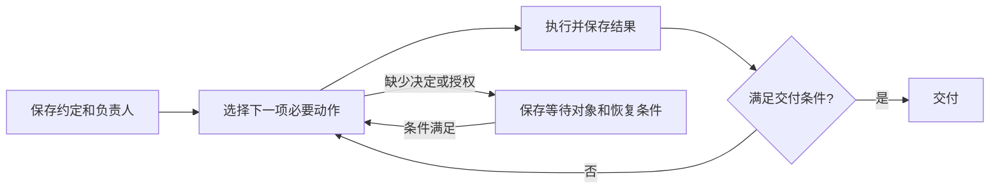

# AgentHub 自适应多 Agent 自主推进 Spec

日期：2026-10-23。状态：用户已确认并授权实施；首版已实现，协议、离线回归与浏览器场景验收通过。真实 Provider 的端到端开发能力及实际生产发布未在本轮验收。实际覆盖和运行限制以[验收记录](../acceptance/2026-10-23-adaptive-work.md)为准。

适用范围：当前 AgentClub 仓库中的 AgentHub 任务协作能力。本文为新的目标方案，替代[上一版共享开发任务约定](2026-10-23-shared-work-contract.md)中的固定流程假设；已有实验代码和测试不代表满足本 Spec。

## 1. 问题与目标

用户交代一件事后，系统应在授权范围内持续对结果负责：保存约定、选择必要动作、按需协作、验证结果，并在确实需要人类决定时提出具体问题。用户不需要反复转述需求、手动交接或回复“继续”。

任务可能是局部修复、无 UI 的后端功能，也可能是需要设计探索的完整产品功能。固定的“需求 → 设计 → 开发 → 审核”角色队列不能作为所有任务的执行协议。

### 1.1 用户需求来源

本 Spec 依据 2026-10-23 的需求讨论及用户对方案的确认：

| 需求 | 约定 |
| --- | --- |
| R-01 可追溯约定 | 工作开始前明确目标、范围和怎样算完成；约定深度与不确定性匹配 |
| R-02 持久责任 | 用共享任务保存责任、进度、产物和下一步；聊天结束不导致工作丢失 |
| R-03 有据交付 | 验证、审核和批准绑定具体需求及产物版本，保留原始依据 |
| R-04 自适应协作 | 单 Agent 可以完成简单任务；设计、分工和独立审核按实际需要加入 |
| R-05 自主接续 | 已授权且条件满足的工作自动推进；需要人类决策、缺少授权或无法恢复时才等待 |
| R-06 人类控制 | 用户可改变方向、暂停和取消；生产发布保留用户最终批准权 |

### 1.2 成功表现

- 简单任务可以由一位 Agent 完成，仍能追溯约定与验证。
- 复杂任务能按实际发现调整分工，所有交接保持责任连续。
- 关闭页面不影响后台已获授权的执行；服务中断后可核对状态并安全恢复。
- 用户能看懂“谁负责、实际完成了什么、还缺什么、是否在等我”。
- 交付依据实际结果；一次运行结束、所有成员发言结束、测试数量或赞同人数均不等于需求完成。

## 2. 最小必要闭环与首版边界

最小闭环为：**保存目标与验收条件 → 选择下一项必要动作 → 执行并保存结果 → 检查是否满足交付条件**。未满足则继续；需要决定或授权时保存等待；满足后交付。

### 2.1 首版必须支持

1. 持久工作卡、轻量且版本化的约定、一个明确的交付负责人。
2. 单 Agent 自主闭环，以及按能力、依赖和审核要求创建的协作任务。
3. 后台调度、持久交接、并发领取保护、有界重试和中断恢复。
4. 产物与验证证据、条件式独立审核、版本有效性检查。
5. 人类决策卡、暂停/恢复/取消，以及指定版本的发布审批记录。
6. 聊天内进度卡与工作详情；已有会话记录仍可查看。

首版面向本地单用户和已配置项目工作区。共享同一工作树的写入串行执行；可证明互不干扰的只读工作允许并行。隔离尚未具备时排队，不把并行写同一工作树当作首版前提。

### 2.2 首版不做

- 固定角色流水线、通用可视化工作流编辑器、常驻多 Agent 辩论或多数投票。
- 为每项工作强制长篇 spec、多版 UI、独立审核、全量测试或人工“启用约定”。
- 自动扩大需求、自动提高自身权限、无限分派和无限返工。
- 多租户权限系统、任意跨项目调度、通用云部署平台。

发布执行复用项目已有且已授权的执行入口。首版定义审批与执行的衔接；若项目未配置发布入口，应明确等待配置，不能显示为已上线。

## 3. 工作卡、责任和运行的关系

### 3.1 最小持久内容

下表规定语义，不要求每行单独建表，也不要求每项工作生成额外文件。

| 内容 | 必需信息 |
| --- | --- |
| 工作身份 | 稳定工作 ID、所属项目/工作区、关联会话、父任务（如有） |
| 开发约定 | 用户原始请求引用或快照、目标、范围边界、可编号验收项、交付终点、约定版本 |
| 责任 | 一个交付负责人、实际执行者；发生转交时保留前后责任人和原因 |
| 进度 | 状态、已取得的结果、下一动作、依赖、等待原因及恢复条件 |
| 产物和依据 | 文件/预览/代码快照引用、版本或摘要、验收项关联、验证与审核记录 |
| 执行约束 | 授权范围、适用项目规则版本、累计预算、暂停/取消控制 |
| 执行历史 | 每次动作、mission/attempt、事件与时间、失败或恢复依据 |

简单约定可以只有目标、范围和验收三项短文本；用户原话与授权在后台关联。验证命令不是所有任务的必填项，例如设计稿可以通过明确的体验检查验证。

交付终点必须明确区分“文档”“可验收的开发产物”“已上线”。用户要求先写 spec 时，终点就是 spec，不得自动进入实现。目标包括上线时，待审批、发布失败均不算根任务完成。

### 3.2 一个结果负责人，按需多个参与者

- 用户选择的 Agent 默认接单；界面的 `@` 选择应提交明确的角色 ID，不从消息正文解析路由。
- 根任务始终有一个交付负责人，负责原始目标、下一步选择和整体结果。
- 只有需要独立分派、等待依赖或单独验收的工作才创建子任务；读文件、运行一条命令无需都变成任务卡。
- 子任务有明确交付物、唯一责任人及引用的约定。委派不解除父任务负责人的责任。
- 转交须在持久记录中完成接收；新责任人尚未接受时，原责任人继续负责。跨角色移交须满足项目允许的分派范围。
- 新会话、新 Provider 或新执行尝试不等于更换负责人。Provider 不可用时可以在授权内恢复同一角色的执行。
- 能力、工具权限、可用性和独立性用于选择参与者。人格名称不固定为产品、设计、开发或审核权限。

### 3.3 与 conversation、mission 的关系

工作项独立于单次聊天和 mission。conversation 是沟通与展示入口，mission 是一次有界执行的载体；同一工作可以跨多次 mission 接续。

恢复所需的约定、决定、产物索引和检查点必须来自持久工作记录，不能要求完整聊天历史仍在上下文中。关闭页面或归档会话不等于取消任务；取消必须是明确控制动作。若删除会话将影响仍在运行的工作，必须保留其工作记录和关联依据，或要求明确处置。

## 4. 如何选择下一步

### 4.1 负责人判断，调度器约束与执行

负责人提出下一动作及其理由，至少说明：要消除什么缺口、预期产物或观察结果、由谁执行、需要哪些前置条件。能一次完成的简单工作允许在一个执行回合内完成调查、修改和验证，不必拆成多个模型调用。

调度器依据持久状态检查授权、依赖、预算、工作区占用和项目规则，安排可执行动作。语义判断由 Agent 提出，状态合法性与权限由宿主执行；不能把“模型认为安全”作为绕过规则的凭据。

候选动作包括调查、澄清、设计、实现、委派、验证、审核、交付和恢复核对。这些是可选动作，不是必须顺序经过的阶段。

### 4.2 按条件增加工作

| 条件 | 处理规则 |
| --- | --- |
| 目标清楚、范围局部、验证方式明确 | 直接由一位 Agent 实现并验证 |
| 事实或技术信息不足 | 先调查；能自行查明的问题不交给用户 |
| 存在影响目标、范围或重要体验的选择 | 准备具体选项、推荐及影响，向用户请求决定 |
| 缺少专业能力 | 委派给具备能力且有权限的角色 |
| 有可独立验收且互不干扰的工作 | 可拆分并行，根任务仍负责集成结果 |
| 重要 UI/交互方向尚未确定 | 展示可审阅的原型或预览，并等待相应体验决定 |
| 命中独立审核要求 | 创建针对具体产物的非作者审核任务 |
| 需要超出已有授权的操作 | 完成可做的准备后，等待明确授权 |

有 UI 不自动触发多版设计；已确认的体验不重复确认。无 UI 不自动判为低风险。只有依赖未决事项的动作等待，其余已授权工作可以继续。

### 4.3 首版审核规则

项目规则必须声明审核触发条件并保存版本。首版默认：权限/安全边界、持久化或数据完整性语义、数据迁移、对外 API/事件契约，以及调度/授权/审核规则自身的实质变更，要求独立审核；项目已有更严格规则继续适用。仅读取既有数据或使用既有接口不自动升档。

方向明确、影响局部、可回滚且不命中上述条件的改动，可以由作者完成实际验证后交付。是否独立审核与测试范围分别决定；不因需要审核就自动跑全仓测试。

负责人可增加审核，不能自行免除项目强制要求。执行中发现新风险须重新判断。风险暂不明确时先进行有界调查，不能凭未知直接宣称低风险。

审核者须具备相应能力且不是被审实现的作者；换会话或 Provider 不构成独立性。设计者可以审核另一位 Agent 的实现。规则判断依据、额外审核原因和最终适用规则应可追溯。

## 5. 状态、交接与持续调度

### 5.1 通用工作状态

| 状态 | 语义 |
| --- | --- |
| `ready` | 有下一动作且已满足执行条件，等待调度 |
| `running` | 当前动作已被有效领取并执行 |
| `waiting` | 暂无可执行动作；必须记录在等什么、等谁、如何恢复 |
| `done` | 当前约定的交付条件已满足，交付记录已保存 |
| `cancelled` | 用户明确终止，保留已产生的结果和未完成事项 |

调查、设计、开发、验证和审核是动作类型，不扩展为每个任务必经的状态。待审批属于 `waiting`；“开发已交付”和“已上线”由交付终点及发布记录区分。

等待原因至少区分依赖、人类决定、授权、外部阻塞、恢复核对、预算耗尽和用户暂停。父任务等待子任务时，子任务仍可按条件运行；暂停根任务则阻止其全部后续动作。

### 5.2 每次动作的交接记录

动作结束时保存：实际结果及引用、对应验收项或待解决问题、剩余缺口、建议下一步或等待原因。用户可读摘要和结构化状态由同一事实生成，不能让聊天写“已完成”而任务仍无产物。

状态更新与后续待办必须原子保存，或使用可由数据库恢复的待调度记录。模型调用不占用数据库写事务。通知只是唤醒信号，漏掉通知仍能从持久记录找回可执行工作。

调度触发包括新任务、动作结束、依赖完成、人类决定、资源恢复及服务启动后的状态核对。没有新增条件的等待任务不反复调用模型，也不重复通知用户。

`mission completed`、CLI 退出成功、普通聊天或 stdout 均不能单独将工作标为完成。完成条件见第 7 节。

## 6. 授权、人类决定与预算

### 6.1 授权从任务意图和项目规则继承

明确要求开发，允许在项目既有权限内进行约定范围的开发与验证；“先给方案”“先写 spec”只允许对应交付。自动创建工作卡不扩大权限。提交、合并、发布或外部写入是否允许，分别依据明确的用户授权和项目规则判断，不能一并推定。

系统保存有效授权来源、范围和时间。已被覆盖的操作不重复请求批准；目标或授权发生实质变化时，只补充缺失部分的决定。子任务继承权限交集，不能通过委派获得父任务没有的权限。

### 6.2 人类决策卡

卡片包含：需要决定的问题、具体产物或选项、推荐与影响、决定适用的需求/产物版本。允许用户选择、提出修改或取消；自然语言决定只有在对象和含义无歧义时才写入结构化记录。

未回答、超时、关闭页面都不构成同意。重复提交同一决定不得重复调度。旧页面针对旧版本的决定应明确失效，不得默默用于新版本。

生产发布必须取得用户对候选版本和目标环境的明确批准。执行前重新检查版本及环境；批准后若候选改变，需要新的批准。发布结果须核对实际状态；配置缺失或结果未知时保留等待，不能显示成功。

### 6.3 有界推进与用户控制

首版建议默认预算：每个根任务最多 20 次 Agent 执行尝试，同一可安全重试的失败动作最多自动重试 2 次，连续 3 次无可检查进展则停止自动推进。预算可由项目或用户调整，作为任务启动时的规则快照保存；这些数值是本 Spec 的初始产品选择，不是已验证的最佳值。

规划、委派后的执行、审核、返工和 Provider 失败尝试均计入根任务累计预算；重启、换角色、新建子任务或新 mission 不重置预算。宿主的纯状态查询不计为 Agent 尝试；实际模型调用还受已有 Provider 超时与配额限制。

进展必须引用新产物、验证观察或已解决的明确问题。摘要文字变化不自动重置无进展计数。宿主可检查引用和版本变化，但不宣称能自动证明任意语义进展；预算上限始终有效。

达到上限时保存已尝试动作、失败证据、剩余问题及建议，等待明确的预算调整或任务变更。不得把失败自动转成完成。

暂停采用“停止启动后续动作”的语义，当前动作可以受控收尾并保存结果；界面须显示仍在运行的动作。取消后禁止后续动作并尝试停止当前执行，已发生副作用不会被假定撤销。恢复时复核有效权限与实际状态后接续。

## 7. 证据、版本与完成条件

### 7.1 证据要求

证据至少关联工作、约定版本、验收项、产物版本、采集者或执行来源、时间及观察结果。按任务选择真实命令输出、实际操作记录、可重放交互、截图或可检查文档。

- 代码必须能定位到可复现的内容：提交 SHA，或基准 SHA 加保存的补丁/工作区快照摘要。仅记录 HEAD 而忽略未提交改动不够。
- 验证须针对所记录的产物；测试期间目标变化则不能把结果直接归到新版本。
- 命令成功只证明该命令覆盖的内容；截图只证明可观察外观，不能单独证明提交、持久化或恢复行为。
- 未运行、无法访问、失败与通过分别显示。模拟 Provider 的演示输出不能作为真实开发验收或发布证据。

### 7.2 独立审核与版本变化

审核记录包含原始约定引用、产物版本、检查范围、证据引用和结论。审核者对照用户要求检查实际结果；作者摘要不能替代原始需求。未解决的阻断问题使相关交付条件不成立。

需求、设计或代码改变后，负责人提出受影响的任务、证据和决定清单；宿主立即将相关完成依据标为待重新确认适用性，不能先继承通过再补理由。复用依据必须能说明变更未影响原检查范围；影响不明时重新验证相关部分。需要独立审核的变化仍由非作者判定，作者不能自行给自己的新实现续签。

保留全部历史结论及其适用版本。历史 `done` 表示当时版本的交付，不自动变成新约定的完成；新修订以关联的后续工作继续，父任务只消费适用于当前目标的结果。

### 7.3 系统接受完成的条件

只有以下条件同时满足，宿主才接受负责人提出的完成请求：

1. 约定及交付终点明确，验收项均有适用的结果与依据。
2. 必需依赖已满足；父任务已检查集成后的整体结果，不能只汇总子任务成功状态。
3. 适用的独立审核已经完成，且无未解决阻断项。
4. 所需人类决定和授权有效；若交付终点为上线，实际发布结果已确认。
5. 最终产物、当前版本、验证范围与已知限制已保存并可供用户查看。

宿主执行结构、引用、权限和状态检查；自然语言目标是否实现仍需要负责人及适用审核者的判断和真实证据。不能宣称 schema 校验本身证明产品正确。

## 8. 中断恢复、幂等与依赖安全

- 每项可执行动作只有一个有效领取者，执行身份及版本由宿主绑定。旧尝试的迟到结果不能覆盖新检查点。
- 操作和结果回写携带稳定操作 ID；重复请求返回原结果，不重复创建任务、计入完成或安排发布。
- 状态更新校验当前修订；并发更新冲突后重读，不能覆盖新的用户决定或取消状态。
- 服务恢复时先核对未完成尝试。确认未执行或可以安全重试的动作自动接续；确认已经完成的效果记入记录后推进。
- 外部操作结果未知时优先查询实际状态，查不清则等待；不承诺通用的严格“只执行一次”，不盲目重放发布、迁移等副作用。
- 同一工作区启动新写入前，确认旧进程已退出或已被可靠隔离。数据库租约过期本身不能阻止旧 CLI 继续写文件。
- 审核和验证使用明确且稳定的候选内容；若只能使用共享工作树，应占用相应资源直至本次检查结束。
- 创建依赖时拒绝自依赖和循环。依赖被取消或不可用时，通知负责人调整或明确等待，不能把缺失依赖当完成。
- “用户主动暂停”必须跨重启保留；普通服务中断不自动等同于用户暂停。授权仍有效时，恢复流程无需用户重新讲述需求。

## 9. 用户可见体验

### 9.1 工作卡

聊天内显示目标、负责人、当前实际结果、下一步、正在等待的对象，以及产物/证据入口。详情中可查看约定历史、子任务、验证、审核和决定记录。

通知聚焦需要决定、真实阻塞、可验收成果和最终交付。后台重复检查、无变化的等待和普通内部交接不持续打扰用户。

### 9.2 三条代表路径

| 用户任务 | 预期路径 |
| --- | --- |
| 修复局部 CSV 中文乱码 | 短约定 → 一位 Agent 修复 → 用实际导出文件验证 → 开发交付；需要上线则另等发布批准 |
| 修复后台权限漏洞 | 明确权限场景 → 实现 → 权限验证 → 非作者审核 → 交付或待发布 |
| 开发体验方向未定的新功能 | 整理目标 → 必要的体验原型与用户决定 → 按需分工 → 集成验证与适用审核 → 交付或待发布 |

具体任务可以增加、跳过或并行部分动作；每次变化都必须能对应一个目标缺口或约束。修复简单问题不要求用户选择 UI；用户明确要求多版 UI 时，该产物成为本次约定的一部分。

## 10. 与现有架构的衔接

| 现有能力 | 目标职责 |
| --- | --- |
| `backend/app/storage/repository.py` / SQLite | 持久工作、约定、决定、证据、预算及待调度事实；事务保证交接一致性 |
| `backend/app/orchestration/runner.py` / MissionRunner | 执行有界动作并报告结果；一次 mission 完成不直接关闭根任务 |
| `backend/app/adapters/provider_router.py` | 在已授权配置内选择可用 Provider，不承担需求完成判定 |
| `backend/app/mcp/tools.py` / MCP | 宿主绑定工作、角色、attempt 与权限；结构化读取、检查点、提交与协作 |
| 实验性的 `backend/app/work/` | 可复用持久化、校验与展示代码；固定 reviewer、人工启动和重启规则需按本 Spec 重新评估 |
| 会话与共享任务前端 | 展示工作事实和人类决定入口，不把实现字段直接变成用户流程 |

新增持久调度应接在现有执行栈上，不能另造一个不受 MissionRunner 预算和 MCP 身份约束的 A2A 通道。Agent 间调用继续经过 `invoke_agent` 及其宿主入队机制；持久工作调度负责保存与恢复这些交接，不解析聊天中的 `@` 来分派。

读取工作、更新约定/检查点、提交产物、提交审核、请求人类决定均需有结构化语义。用户决定、暂停、取消和预算调整由用户侧权限控制；Agent 只能提出请求。具体字段与端点在实现设计中确定，但两类 MCP 通道必须执行相同的身份、版本、权限和幂等检查。

保持[现有铁律](../architecture/iron-laws.md)：stdout 不升格为正式消息、动态 MCP 配置不污染用户全局目录、A2A 统一入口、默认 Fake Provider 且真实 Provider 默认关闭。若执行工具无法限制声明的权限，不得只靠提示词宣称已实现限制；相关能力应明确不可用。

旧记录保留原协议含义，不自动改写其审核或授权。旧版正在执行的工作不得静默切换协议；按原边界受控收尾/暂停，后续以关联的新工作承接，并重新判断可复用的授权与证据。

## 11. 验收标准

以下验收定义实现完成的依据；本 Spec 编写完成不代表这些检查已经通过。

| ID | 场景与通过条件 | 对应需求 |
| --- | --- | --- |
| AC-01 | 低风险且已授权的局部任务保存短约定后，由一个 Agent 完成实际验证和交付；不强制设计、第二位 Agent 或额外“继续” | R-01、R-04、R-05 |
| AC-02 | 用户只要求 spec 时交付文档并结束；不启动代码实现。明确开发授权可以覆盖内部交接，子任务不能扩大权限 | R-01、R-06 |
| AC-03 | 重要体验选择展示具体产物并等待决定；无 UI 和局部文案任务不自动进入设计流程，未依赖该决定的已授权工作仍可继续 | R-04、R-05 |
| AC-04 | 权限、数据完整性等命中规则的任务要求非作者审核；作者不能取消审核要求或自审，新会话不改变作者身份 | R-03、R-04 |
| AC-05 | 委派后父任务保留唯一交付负责人，子任务有明确产物与责任人；发消息或子 mission 结束不解除父任务责任 | R-02、R-05 |
| AC-06 | 关闭页面后后台继续已授权工作；重新打开可见最新进度、等待对象和产物，恢复不依赖完整聊天上下文 | R-02、R-05 |
| AC-07 | 发现范围内的新问题可调整动作并记录理由；不能自行扩大目标或降低验收，循环依赖被拒绝，依赖未满足不得执行 | R-01、R-04 |
| AC-08 | 需求/设计/代码改变后，旧证据和审核仍保留原适用版本；新交付只消费已证明仍有效或补验后的依据 | R-03 |
| AC-09 | 重复通知、重复提交和并发领取不造成重复有效执行或状态推进；过期尝试不能覆盖新状态，旧写入进程未退出不能启动冲突写入 | R-02、R-05 |
| AC-10 | 模拟服务在“效果已发生、结果未写回”时中断：恢复后先核对；确认安全则自动接续，未知副作用明确等待且不盲目重放 | R-02、R-05、R-06 |
| AC-11 | 子任务均完成但组合功能不符合约定时，父任务保持未完成；必须完成集成验收，未验证事项不能显示通过 | R-01、R-03 |
| AC-12 | 生产发布等待用户批准具体版本和环境；批准重试不重复发布，候选改变不复用旧批准，实际发布未确认不显示已上线 | R-03、R-06 |
| AC-13 | 多次失败、无进展或总预算耗尽后停止自动消耗，显示具体证据和下一决定；拆任务、重启或换 Provider 不能重置累计预算 | R-02、R-05、R-06 |
| AC-14 | 暂停后不启动新动作且状态跨重启保留；当前动作状态可见。恢复后接续；取消不伪称已回滚副作用 | R-02、R-06 |
| AC-15 | CLI 成功、普通聊天完成声明或演示输出均不能替代真实证据；只有原约定的完整交付条件满足才能变为 `done` | R-01、R-03 |
| AC-16 | 自然语言决定指代不清时不执行；旧版本决定明确失效；重复决定不重复推进；未回复和超时均不等于批准 | R-03、R-06 |
| AC-17 | 缺少发布适配器时明确显示等待配置；目标仅为开发产物时可交付，目标包含上线时根任务仍未完成 | R-01、R-05 |
| AC-18 | 旧协议工作与圆桌讨论保留原语义；新任务不继承旧版固定审核/人工启用限制，也不绕过既有铁律和权限 | R-02、R-04、R-06 |

实现验收应覆盖状态/权限与幂等检查、可控中断恢复、三条代表路径的端到端体验。Fake Provider 可用于验证协议流转，但真实产物、真实验证和发布衔接需另有对应证据；本轮文档变更不运行业务测试，也不声明功能通过。

## 12. 实现顺序与观察指标

建议按可验收的纵向切片实现，顺序不是运行时强制流程：

1. 单 Agent 持久闭环：短约定、责任、执行、证据、交付、暂停与恢复。
2. 按需协作：能力分派、子任务依赖、结果集成和条件式独立审核。
3. 人类决定与交付边界：设计选择、版本变化处理、发布审批及已配置执行入口。

每个切片都包含相应权限、预算与恢复要求；不能先上线一个无边界的自动循环再补控制。

优先观察：提出需求到首个可验收成果的时间、人工介入次数及原因、简单任务引入的 Agent 数量、返工成本，以及中断恢复与重复副作用情况。先建立基线，不在本 Spec 中虚设提升比例，也不以“参与 Agent 更多”作为成功指标。

## 13. 参考与历史方案差异

- [Clowder 开发 SOP](https://github.com/zts212653/clowder-ai/blob/main/docs/SOP.md)：参考按风险选择必要动作、已确认方向内自主推进、局部任务的短路径。本文的预算、状态和首版边界是 AgentHub 的设计选择。
- [Clowder request-review](https://github.com/zts212653/clowder-ai/blob/main/cat-cafe-skills/request-review/SKILL.md)：参考对照原始约定与实际产物、非作者审核、证据覆盖具体版本。
- [既有共享任务实验说明](../SHARED_WORK.md)：可复用实现材料，不作为本 Spec 已完成的证明。

| 旧实验假设 | 本 Spec 的目标 |
| --- | --- |
| 每项任务必有执行人和独立审核人 | 每项任务有责任人，独立审核按规则触发 |
| 每版约定必须手动启用 | 从用户意图与已有授权确定可做范围，缺少必要决定时才等待 |
| 固定执行 → 验证 → 审核 | 动态选择下一项必要动作；验证始终存在，独立审核按需 |
| 服务重启后一律暂停、人工重试 | 核对实际效果后安全自动接续；主动暂停和未知副作用分别处理 |
| 每次提交必须绑定干净 Git HEAD | 产物必须有可复现版本；代码可使用提交或完整保存的内容快照 |
| 一次任务审核通过近似代表完成 | 当前约定、整体结果、有效证据和所需批准共同决定交付 |
